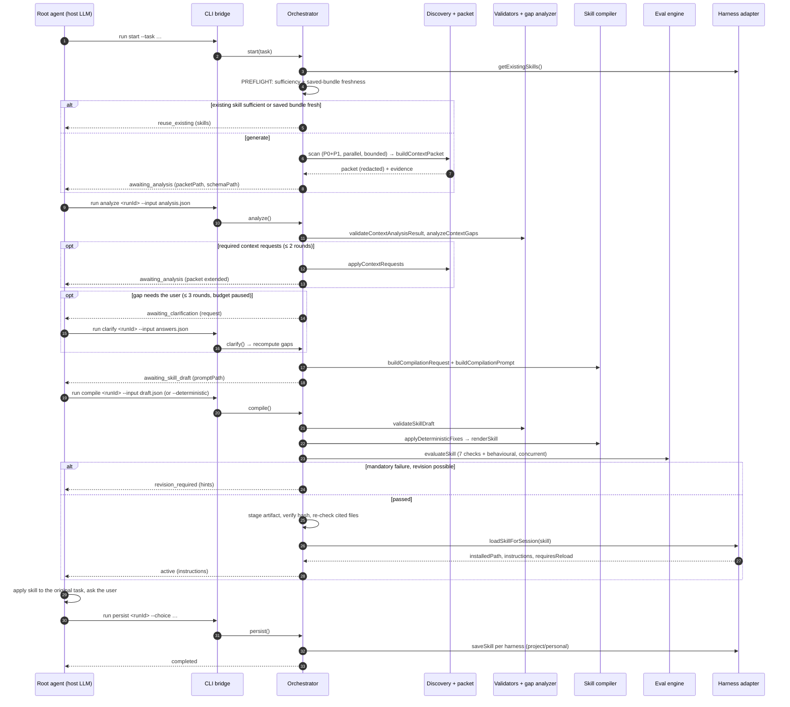
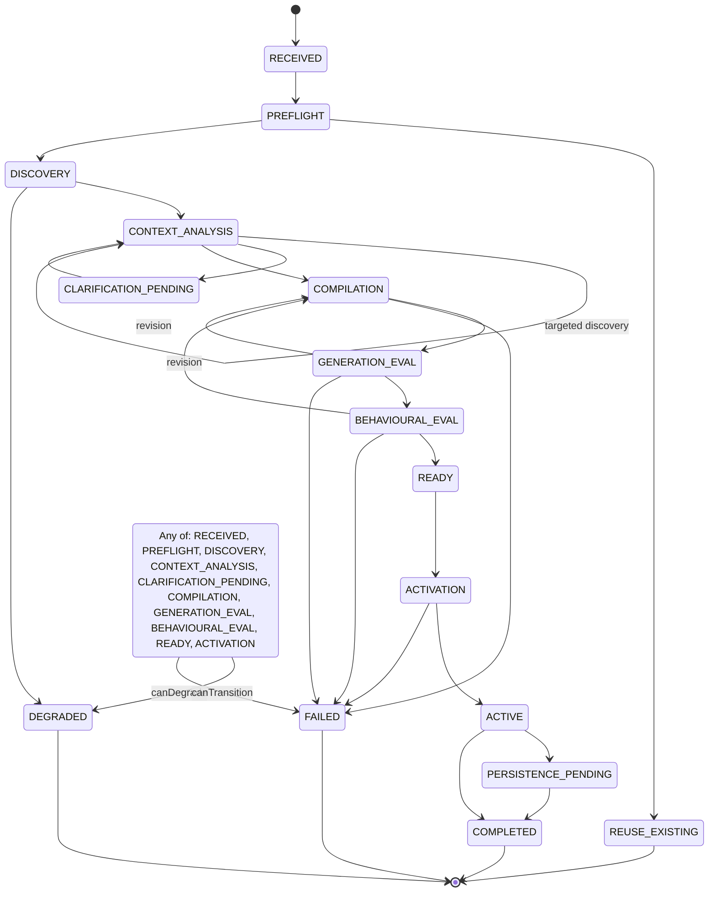

# Architecture

This guide maps the code to the design. It is for contributors who need to find where a behaviour lives. For the JSON contract the root agent sees, read [bridge-protocol.md](bridge-protocol.md).

Dynamic Skills is one npm package ([ADR-010](adr/010-single-package.md)). Each logical module from TechDesign §12.1 is a folder under `src/` with an `index.ts` barrel, and `src/index.ts` re-exports all of them. The core owns no LLM: the root agent (the host) writes the Context Analysis Result and the SkillDraft; the core does everything deterministic and owns state, budget and evaluation (TechDesign §3, ADR-001).

## Module map

| Module (`src/…`) | TechDesign | Responsibility | Main exports |
| --- | --- | --- | --- |
| `contracts/` | §4–§11, §17, §19 | Shared, versioned types and constants. Every other module depends on it. | `GenerationState`, `DEFAULT_CONFIG`, `DynamicSkillsConfig`, `STAGE_BUDGET_MS`, `HARNESS_IDS`, `ContextPacket`, `ContextAnalysisResult`, `SkillDraft`, `GeneratedSkill`, `SkillEvaluationReport`, `CanonicalBundleRecord`, `ErrorInfo` |
| `core/` | §5.2, §6.4, §16, §17 | Errors, monotonic clock, hashing, token estimates, safe file reads, redaction, atomic writes, timeouts. | `DynamicSkillsError`, `dsError`, `monotonicNowMs`, `clockEpoch`, `sha256`, `hashSkillFiles`, `estimateTokens`, `readTextFileBounded`, `isExcludedPath`, `isSensitivePath`, `resolveRealInsideRoot`, `redactSecrets`, `writeFileAtomic`, `writeDirAtomic`, `withTimeout`, `mapWithConcurrency`, `newId`, `evidenceId` |
| `discovery/` | §5.1, §5.2, §15.2 | File index, repository identity, 13 bounded discovery providers run in parallel with per-provider timeouts. | `RepositoryScanner`, `createDefaultProviders`, `buildFileIndex`, `discoverExistingSkills`, `getRepositoryIdentity`, the `*Provider` classes |
| `evidence-registry/` | §5.4 (evidence distinction) | Evidence provenance; classifies analysis claims as observed / inferred / conflicting. | `EvidenceRegistry` |
| `context-packet/` | §5.3, §5.5 | Builds the Context Packet within file, byte and token limits; applies targeted context requests. | `buildContextPacket`, `applyContextRequests`, `checkRequestPath`, `DEFAULT_DISCOVERY_LIMITS`, `resolveLimits` |
| `context-analyzer-contracts/` | §5.4, §6.1, §7.1 | JSON Schemas plus semantic validation of everything the host writes. | `schemaPath`, `validateContextAnalysisResult`, `validateClarificationResponse`, `validateSkillDraft`, `validateContextRequest` |
| `context-gap-analyzer/` | §5.6, §13.1 | Skill sufficiency (reuse) and gap analysis (ask user, targeted discovery, document assumption). | `analyzeContextGaps`, `assessSkillSufficiency` |
| `clarification-manager/` | §6.1–§6.3, §6.5 | Clarification rounds, question dedupe, assumption registry. | `ClarificationManager` |
| `sla/` | §6.4, §15.4, §15.5 | Pause-aware active-time budget that survives process boundaries. | `ExecutionBudget` |
| `skill-compiler/` | §7 | Compilation request and prompt, deterministic fallback draft, deterministic fixes, canonical `SKILL.md` rendering and parsing. | `buildCompilationRequest`, `buildCompilationPrompt`, `compileDeterministicDraft`, `applyDeterministicFixes`, `renderSkill`, `parseSkillMarkdown` |
| `eval-engine/` | §8 | Seven generation checks, behavioural smoke eval, baseline comparison, revision policy. | `evaluateSkill`, `GENERATION_CHECKS`, `check*`, `createBehaviouralEvalCase`, `runBehaviouralSmokeEval`, `compareWithBaseline`, `planRevision` |
| `storage/` | §10.2, §10.5, §16.3 | Runtime directory, staged run artifacts, canonical bundles, install-registry paths. | `ArtifactStore`, `runtimeRoot`, `ensureRuntimeRoot`, `runDir`, `bundleRoot`, `installRegistryPath`, `assertSafeSkillName` |
| `lifecycle/` | §10.5, §10.6 | Context fingerprints, freshness decisions, bundle reuse candidates, version bumps. | `computeContextFingerprint`, `assessFreshness`, `findReusableBundles`, `nextSkillVersion` |
| `activation/` | §9 | Session activation into a watched skills directory, ownership registry, verification. | `DirectorySkillActivator`, `InstallRegistry`, `inspectInstall`, `verifyActivation` |
| `adapter-sdk/`, `adapters/` | §9.3, §11 | Harness adapters for Claude Code, Codex and OpenCode. Covered by the harness adapters guide (docs/adapters.md, in progress). | `BaseHarnessAdapter`, `createAdapter`, `detectHarnesses`, `installBootstrap` |
| `orchestrator/` | §3.2, §4, §15.5, §17, §19 | State machine, run store, config loading, the bridge commands. | `Orchestrator`, `BridgeResponse`, `canTransition`, `TERMINAL_STATES`, `expectedCommand`, `loadConfig`, `resolveConfig`, `RunStore`, `RUN_FILES` |
| `cli/` | §14 | The `dynskills` CLI (`init`, `doctor`, `validate`, `inspect`, `benchmark`, `list`, `clean`, `run …`). | `buildProgram` |
| `benchmark/` | §18.7 | Benchmark runner with a deterministic stand-in host. See [benchmarks/README.md](../benchmarks/README.md). | `runBenchmarks`, `formatBenchmarkTable`, `standInAnalysis` |

## Lifecycle of one run

Each step is one CLI process ([ADR-012](adr/012-cli-bridge.md)). The orchestrator loads `run.json`, takes the run lock, advances the state machine, saves, and prints one JSON response. The diagram shows the generation path; error and degrade paths are in the [state machine](#state-machine) below.

## Where state lives on disk

| Location | Written by | Contents |
| --- | --- | --- |
| `<repo>/.dynamic-skills-runtime/` | `ensureRuntimeRoot` | Runtime root. Contains a `.gitignore` with `*`, so git ignores it without touching the user's `.gitignore`. Also excluded from discovery. |
| `…/sessions/<sessionId>/runs/<runId>/` | `RunStore` | One directory per run (files below). |
| `…/runs/<runId>/skills/<name>/` | `ArtifactStore.stageSkill` | The evaluated artifact, staged before activation. Re-staging in the same run replaces it. |
| `<repo>/.dynamic-skills-runtime/installs/<harness>.json` | `InstallRegistry` | Ownership registry for skill directories Dynamic Skills installed into project skill dirs (ephemeral and project scope). |
| `<repo>/.dynamic-skills/bundles/<name>/` | `ArtifactStore.saveCanonical` | Canonical project bundle: `bundle.json` (a `CanonicalBundleRecord`) and `skill/**` (the artifact). |
| `~/.dynamic-skills/bundles/<name>/` | same | Canonical personal bundle (`repositoryId: "*"`). |
| `~/.dynamic-skills/installs/<harness>.json` | `InstallRegistry` | Ownership registry for personal installs. |
| `<repo>/dynamic-skills.config.json` | the user | Optional configuration ([configuration.md](configuration.md)). |

Session ids come from `DYNAMIC_SKILLS_SESSION_ID`, then `CLAUDE_SESSION_ID`, `CODEX_SESSION_ID`, `OPENCODE_SESSION_ID` (each must match `^[A-Za-z0-9_-]{1,80}$`), else `sess_<YYYY-MM-DD>`.

### Run files (`RUN_FILES` in `src/orchestrator/run-store.ts`)

| Key | File | Written |
| --- | --- | --- |
| `record` | `run.json` | Every command. The `RunRecord`: identity, state, history, task, config snapshot, budget snapshot, gaps, clarification state, assumptions, skill, evaluation summary, activation, persistence, discovery fingerprint, revision info, metrics, `lastRequest`. |
| `packet` | `context-packet.json` | `start`; rewritten when targeted discovery extends it. |
| `registry` | `evidence-registry.json` | `start`; updated by `analyze`. |
| `analysis` | `context-analysis.json` | `analyze`, when the submission is valid. |
| `clarificationRequest` | `clarification-request.json` | When a clarification round opens. |
| `compilationRequest` | `compilation-request.json` | On entering `COMPILATION`. |
| `compilePrompt` | `compile-prompt.md` | On entering `COMPILATION` (the prompt `promptPath` points to). |
| `draft` | `skill-draft.json` | `compile`, after deterministic fixes. |
| `evaluation` | `evaluation-report.json` | `compile`, the full `SkillEvaluationReport`. |
| `evalCase` | `behavioural-eval-case.json` | `compile`. Reused for the baseline comparison at `persist`. |
| `lock` | `.lock` | Exists only while a command holds the run lock. |

All JSON is written atomically (temp file + rename).

### Harness skill directories

| Harness | Project | Personal |
| --- | --- | --- |
| Claude Code (`claude`) | `.claude/skills/` | `~/.claude/skills/` |
| Codex (`codex`) | `.agents/skills/` | `~/.agents/skills/` |
| OpenCode (`opencode`) | `.opencode/skills/` | `~/.config/opencode/skills/` |

Session (ephemeral) activation installs into the **project** directory of the run's harness and records the install with scope `ephemeral`. `persist --choice project|personal` removes that session install, then writes the artifact into the chosen scope's directory of every selected harness.

## State machine

`src/orchestrator/state-machine.ts` has two layers:

1. An explicit `TRANSITIONS` table (all edges in the diagram except those from the grey box).
2. `canTransition` rules: any state that is not terminal and is not `ACTIVE` or `PERSISTENCE_PENDING` may also move to `DEGRADED` or `FAILED`. The box stands for those ten states.

Terminal states: `COMPLETED`, `REUSE_EXISTING`, `DEGRADED`, `FAILED`.

`ACTIVE` and `PERSISTENCE_PENDING` can neither degrade nor fail: once a skill is active, the budget no longer applies and only `persist` or `cancel` can finish the run. An illegal transition throws an `invalid_state` error.

What the orchestrator actually does with these edges:

| Transition | When |
| --- | --- |
| → `DEGRADED` | Budget expired at the start of a command or a stage timed out; `analyze` invalid three times; `cancel` before activation; any unexpected error outside `COMPILATION`, `GENERATION_EVAL`, `BEHAVIOURAL_EVAL`, `ACTIVATION`. |
| → `FAILED` | Invalid draft or failed mandatory evaluation with no revision left; staged hash mismatch; cited files changed since discovery; adapter activation failure; any unexpected error in `COMPILATION`, `GENERATION_EVAL`, `BEHAVIOURAL_EVAL`, `ACTIVATION`. |
| `CONTEXT_ANALYSIS` → itself | Targeted discovery added files to the packet (at most 2 rounds). |
| `ACTIVE` → `PERSISTENCE_PENDING` | Always, in the same `compile` call. A successful `compile` therefore reports state `PERSISTENCE_PENDING`. |
| `ACTIVE` → `COMPLETED` | Not used by the orchestrator. |

### Differences from TechDesign §4.1

- The design diagram has no `CONTEXT_ANALYSIS` self-loop; the code uses it for targeted discovery (§5.5).
- The design shows `DEGRADED` only from `DISCOVERY` and `FAILED` only from `COMPILATION`, `GENERATION_EVAL` and `ACTIVATION`. The code allows both from every non-terminal state except `ACTIVE` and `PERSISTENCE_PENDING`, and has an explicit `BEHAVIOURAL_EVAL → FAILED`.
- §10.2 stages skills under `skills/<skill-id>/`; the code uses `skills/<name>/`.
- Discovery in a run is capped at priority `P1` (`maxPriority: "P1"`); no provider is currently registered as `P2`.
